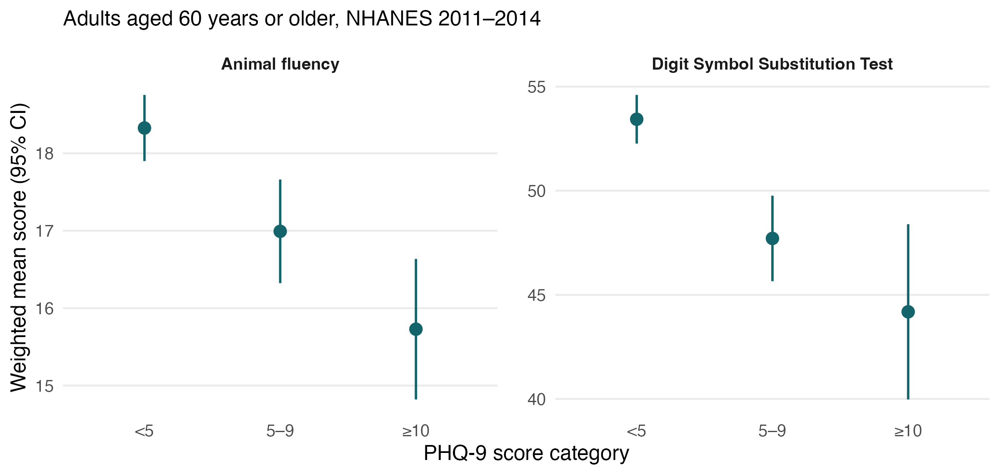

# Depressive symptoms and cognitive function in older adults

## About this repository

This project was built in about one hour with an agentic AI workflow (OpenAI Codex as the
coding agent and Anthropic Claude as the reviewer). I defined the research question, reviewed
and approved each analytic decision, and verified the results. AGENTS.md contains the
instructions the AI agent followed.

Are greater depressive symptoms associated with poorer cognitive test performance among U.S. adults aged 60 years or older?

[Read the full report](https://drabrahamvalles.github.io/nhanes-depression-cognition-ai-pipeline/) · [View the GitHub repository](https://github.com/drabrahamvalles/nhanes-depression-cognition-ai-pipeline)

## Data and methods

We linked the public NHANES 2011–2012 and 2013–2014 demographics, depression screener, and cognitive functioning files by `SEQN`. The survey design uses four-year examination weights, strata, and primary sampling units. Survey-weighted linear regressions relate each test score to continuous PHQ-9, adjusting for age, sex, education, and race and ethnicity. Each model includes participants with an observed score for that test.

## Main finding

A higher PHQ-9 score was associated with lower adjusted scores on CERAD learning, CERAD delayed recall, animal fluency, and the Digit Symbol Substitution Test (DSST). For DSST, each additional PHQ-9 point was associated with a 0.60-point lower score (95% CI, 0.39 to 0.81 points lower).



## Limitations

The cross-sectional design cannot establish temporal order or causality. Public-use ages of 80 years and older are recorded as 80, limiting age adjustment in the oldest group. The data describe 2011–2014, and missing test scores may affect who is represented in each model.

## Reproduce the analysis

Install R and Quarto. From the repository root, restore the R packages and run the scripts in order.

```sh
Rscript -e 'renv::restore()'
Rscript R/01_download.R
Rscript R/02_clean.R
Rscript R/03_analysis.R
Rscript R/04_figures.R
```

Rebuild the self-contained HTML report.

```sh
quarto render report/report.qmd
mkdir -p docs
mv report/report.html docs/index.html
```

