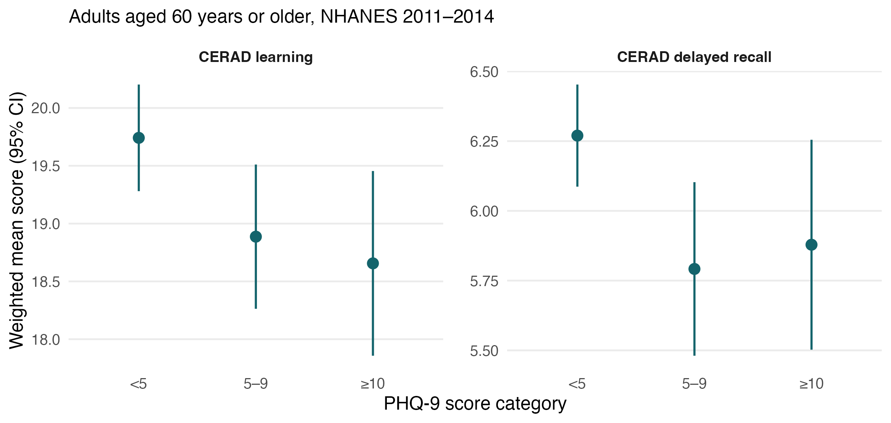
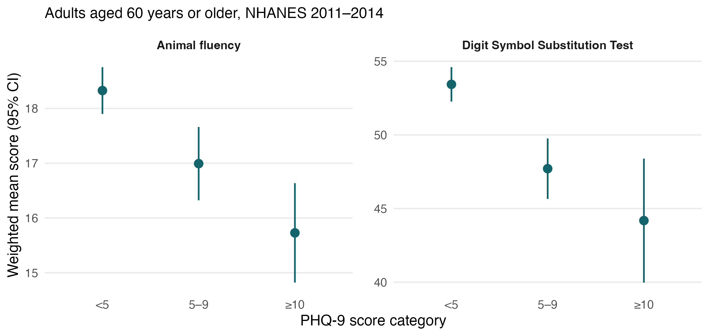

## Background

Cognitive performance in older adulthood spans several domains, including memory, verbal fluency, and processing speed. The National Health and Nutrition Examination Survey (NHANES) measured depressive symptoms and administered cognitive tests during the same survey cycles. This study examined whether higher depressive symptom scores were associated with lower cognitive test scores among U.S. adults aged 60 years or older.

## Methods

### Data and analytic sample

We pooled the public 2011–2012 and 2013–2014 NHANES cycles. Within each cycle, we linked the demographics, depression screener, and cognitive functioning files by participant identifier (`SEQN`). We used the demographics file as the starting sample and retained every participant in the cleaned dataset. [NHANES demographics files](https://wwwn.cdc.gov/Nchs/Nhanes/Search/DataPage.aspx?Component=Demographics) · [NHANES questionnaire files](https://wwwn.cdc.gov/nchs/nhanes/search/datapage.aspx?Component=Questionnaire)

### Sample flow

All counts are unweighted. Exclusions below are sequential.

| Step | Excluded at step | Remaining |
|---|---:|---:|
| Participants in the two demographics files | | 19,931 |
| Restrict to age 60 years or older | 16,299 | 3,632 |
| Require a valid examination weight and design variables | 160 | 3,472 |
| Require a complete PHQ-9 score and adjustment covariates | 288 | 3,184 |

All 160 exclusions at the examination step had a weight of zero. Within the analytic base sample of 3,184, missing cognitive scores led to separate exclusions of 147 for CERAD learning, 150 for CERAD delayed recall, 165 for animal fluency, and 243 for the Digit Symbol Substitution Test (DSST). @tbl-regressions shows the resulting sample size for each model.

### Depressive symptoms

We summed the nine Patient Health Questionnaire items (`DPQ010` through `DPQ090`), scored 0–3 each, to obtain a PHQ-9 total of 0–27. Refused and unknown responses (codes 7 and 9) were treated as missing. The total required all nine items. We used categories of <5, 5–9, and ≥10 for descriptive summaries and the continuous score for regression. [CDC depression screener codebook](https://wwwn.cdc.gov/Nchs/Data/Nhanes/Public/2013/DataFiles/DPQ_H.htm)

### Cognitive tests

We analyzed four scores from three assessments. The Consortium to Establish a Registry for Alzheimer’s Disease (CERAD) learning score was the sum of three immediate word recall trials (0–30), with all three trials required. CERAD delayed recall was scored separately (0–10). Animal fluency counted animals named in one minute. The DSST counted correct symbol–number matches completed in two minutes. Missing scores were handled separately for each test, without imputation. [CDC cognitive functioning codebook](https://wwwn.cdc.gov/Nchs/Data/Nhanes/Public/2013/DataFiles/CFQ_H.htm)

### Survey design and statistical analysis

We created a survey design in R with `survey::svydesign()` using masked primary sampling units (`SDMVPSU`), masked strata (`SDMVSTRA`), and four-year Mobile Examination Center weights (`WTMEC2YR / 2`), with `nest = TRUE`. We built the design on participants with valid examination weights and design variables, then used `subset()` on the design object for the analytic base sample and for each test-specific analysis. [CDC guidance on combining survey cycles](https://wwwn.cdc.gov/nchs/nhanes/tutorials/weighting.aspx)

We summarized participant characteristics with `gtsummary::tbl_svysummary()` and plotted survey-weighted means and 95% confidence intervals by PHQ-9 category. We fit a separate survey-weighted linear regression with `survey::svyglm()` for each test, adjusting for age in years, sex, education, and race and ethnicity. We report the adjusted difference in score per one-point higher PHQ-9, with a 95% Wald confidence interval and a two-sided p-value. [Documentation for survey-weighted regression](https://search.r-project.org/CRAN/refmans/survey/help/svyglm.html)

## Results

The analytic base sample included 3,184 adults. Weighted mean learning, animal fluency, and DSST scores decreased across the three PHQ-9 categories. Mean delayed recall was highest in the <5 category and lowest in the 5–9 category.

::: {.table-responsive}

```{r}
#| label: tbl-characteristics
#| tbl-cap: "Participant characteristics by PHQ-9 category"
table_1 <- readRDS("../output/table_1.rds")
table_1[is.na(table_1)] <- ""
knitr::kable(table_1, format = "html", align = c("l", "r", "r", "r"))
```

:::

*Continuous variables are shown as weighted means (weighted standard deviations). Categorical variables are shown as unweighted counts (weighted column percentages). Header and missing-score counts are unweighted.*

In the adjusted models, a higher PHQ-9 score was associated with lower scores on all four tests.

::: {.table-responsive}

```{r}
#| label: tbl-regressions
#| tbl-cap: "Adjusted associations between PHQ-9 and cognitive test scores"
regressions <- readRDS("../output/regression_results.rds")
regression_display <- data.frame(
  "Cognitive test" = regressions$test,
  "Beta" = sprintf("%.3f", regressions$beta),
  "95% CI" = sprintf("%.3f to %.3f", regressions$ci_low, regressions$ci_high),
  "p-value" = ifelse(regressions$p < 0.001, "< 0.001", sprintf("%.3f", regressions$p)),
  "Unweighted n" = format(regressions$n, big.mark = ",", trim = TRUE),
  check.names = FALSE
)
knitr::kable(regression_display, format = "html", align = c("l", "r", "r", "r", "r"))
```

:::

{#fig-cerad fig-alt="Two panels show CERAD learning and delayed recall means with 95% confidence intervals across three PHQ-9 categories."}

{#fig-fluency-dsst fig-alt="Two panels show lower average animal fluency and DSST scores in successive PHQ-9 categories, with 95% confidence intervals."}

## Limitations

- **Cross-sectional design.** Depressive symptoms and cognition were measured in the same survey period. The temporal order is unknown, and causal effects cannot be inferred.
- **Age top-coding.** The public files record ages of 80 years and older as 80, limiting age adjustment within the oldest group. [CDC demographic codebook](https://wwwn.cdc.gov/Nchs/Data/Nhanes/Public/2013/DataFiles/DEMO_H.htm#RIDAGEYR)
- **Survey period.** The findings describe 2011–2014. Associations in more recent populations may differ.
- **Missing scores and residual confounding.** Participants who completed each assessment may differ from those with missing scores. The models can account only for the measured covariates included.

## Conclusion

Among older adults in NHANES 2011–2014, greater depressive symptom scores were associated with lower performance on four cognitive measures after adjustment for demographic characteristics. Longitudinal data would help clarify the temporal relationship.
